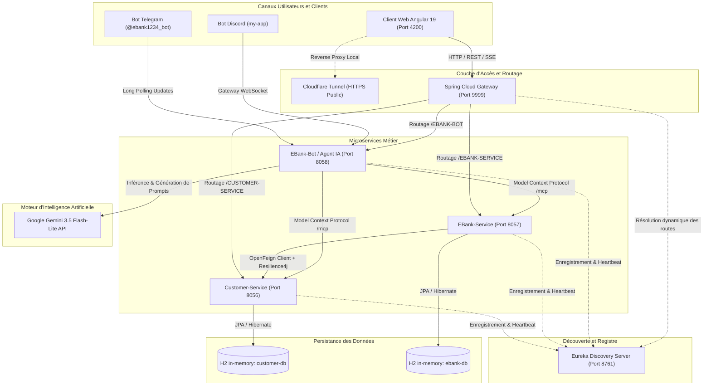
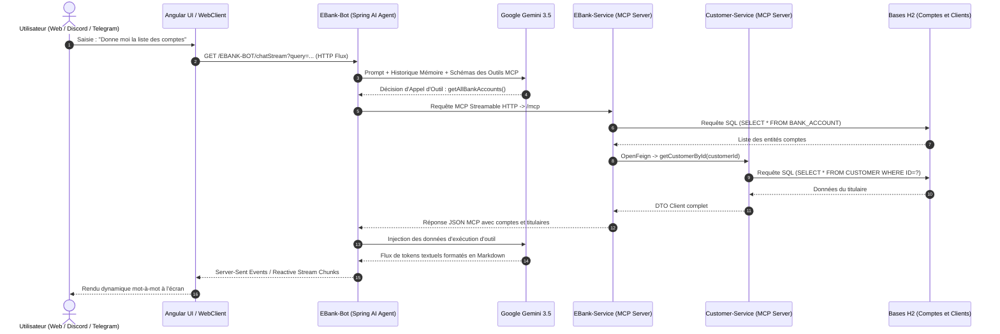

# Architecture du Système — Smart E-Banking Microservices & Spring AI

> Documentation d'architecture technique, choix de conception, résilience et flux de données de la plateforme **Smart E-Banking**.

---

## 1. Vue d'Ensemble (High-Level Design)

La plateforme bancaire distribuée **Smart E-Banking** est conçue selon le paradigme des **Microservices Réactifs et Autonomes**. Elle combine la robustesse de l'écosystème **Spring Cloud**, la flexibilité d'une passerelle API réactive, la puissance de l'**Intelligence Artificielle Générative (Google Gemini 3.5 via Spring AI)** et le protocole standardisé **Model Context Protocol (MCP)** pour la découverte et l'exécution d'outils métier.

L'interface utilisateur adopte une approche moderne **Clean Light UI (Angular 19 & Tailwind CSS)**, offrant une expérience fluide en pleine largeur (*Edge-to-Edge*), des composants de données en grille Bento, et un streaming réactif mot-à-mot des réponses de l'agent.

---

## 2. Cartographie des Composants & Ports Réseau

| Composant | Module | Port | Rôle & Responsabilités | Technologies Clés |
| :--- | :--- | :---: | :--- | :--- |
| **Discovery Server** | `discovery-service` | `8761` | Enregistrement, annuaire dynamique et surveillance de santé (*Heartbeat*) de tous les microservices. | Spring Cloud Netflix Eureka |
| **API Gateway** | `gateway-service` | `9999` | Point d'entrée unique, routage dynamique basé sur la découverte, gestion globale des CORS et sécurité réseau. | Spring Cloud Gateway (WebFlux) |
| **Customer Service** | `customer-service` | `8056` | Gestion du cycle de vie des clients bancaires (CRUD), persistance relationnelle et exposition d'outils MCP. | Spring Boot 4, JPA, H2 Database, Spring AI MCP |
| **EBank Service** | `ebank-service` | `8057` | Gestion des comptes (Courants et Épargne), agrégation OpenFeign avec Customer-Service, tolérance aux pannes et outils MCP. | Spring Boot 4, JPA, OpenFeign, Resilience4j, Spring AI MCP |
| **EBank Bot** | `ebank-bot` | `8058` | Agent conversationnel intelligent, client MCP HTTP streamable, passerelles multi-canaux (Web Streaming, Telegram, Discord). | Spring AI, Google Gemini 3.5 Flash-Lite, TelegramBots, JDA Discord |
| **Client Web UI** | `angular-front` | `4200` | Interface utilisateur web moderne, dashboards Bento Grid, modales contextuelles et streaming Server-Sent Events. | Angular 19, TypeScript, Tailwind CSS, ngx-markdown |

---

## 3. Schéma Architectural Global



---

## 4. Flux Séquentiel : Agent IA & Protocole MCP

Le diagramme suivant illustre le cheminement complet d'une requête utilisateur (*« Donne moi la liste des comptes bancaires »*) via l'interface web ou les bots de messagerie :



---

## 5. Patrons de Résilience & Tolérance aux Pannes

### Circuit Breaker & Fallback (Resilience4j)
Dans `ebank-service`, la communication avec `customer-service` est protégée par un disjoncteur Resilience4j :
```java
@CircuitBreaker(name = "customerService", fallbackMethod = "getDefaultCustomer")
public Customer getCustomerById(Long id) {
    return customerRestClient.getCustomerById(id);
}

public Customer getDefaultCustomer(Long id, Exception exception) {
    return Customer.builder()
            .id(id)
            .name("Client Temporairement Indisponible")
            .email("support@ebank.local")
            .build();
}
```
* **État FERMÉ (*Closed*) :** Les requêtes transitent normalement vers le service client.
* **État OUVERT (*Open*) :** En cas d'indisponibilité ou de dépassement de latence, le disjoncteur bascule automatiquement vers le fallback par défaut sans propager d'erreur HTTP 500.

---

## 6. Protocole Model Context Protocol (MCP)

Le protocole MCP standardise la manière dont les modèles de langage interagissent avec les systèmes d'information :
* **Serveurs MCP :** `customer-service` (port `8056/mcp`) et `ebank-service` (port `8057/mcp`) exposent leurs méthodes métier sous forme d'outils exécutables déclaratifs (`ToolCallback`).
* **Client MCP :** `ebank-bot` se connecte au démarrage via des transports `streamable-http` aux deux microservices.
* **Sécurité & Isolation :** Le LLM ne dispose d'aucun accès direct aux bases SQL ; il génère uniquement une intention d'appel que le client MCP valide et exécute en environnement contrôlé.

---

## 7. Persistance & Cycle de Vie des Données

* **Bases relationnelles H2 en mémoire :** Chaque microservice gère son propre schéma indépendant (`customer-db` et `ebank-db`), garantissant un découplage total sans dépendance partagée de base de données.
* **CommandLineRunner d'amorçage :** Des jeux de données réalistes sont initialisés à chaque démarrage (clients titulaires, comptes courants et comptes épargne avec soldes aléatoires).

